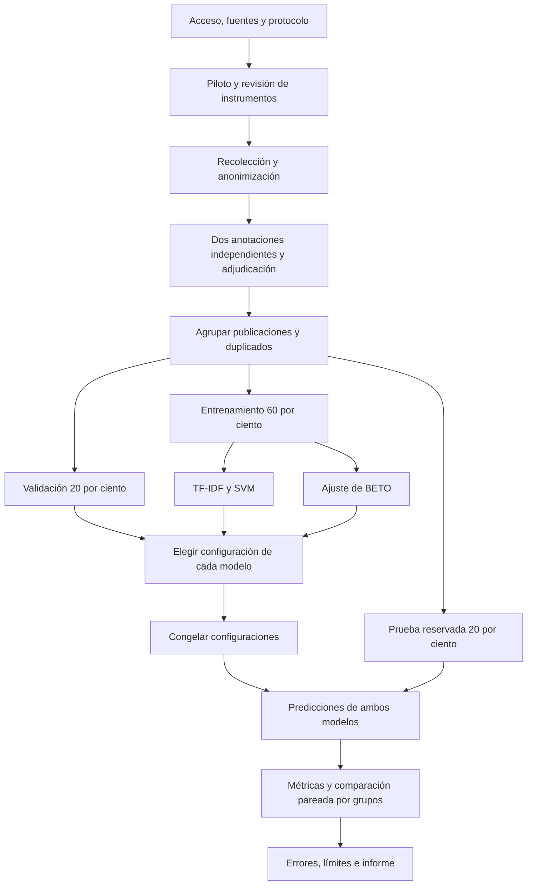

# Esquema del método

OE1: A–E; OE2: F–L; OE3: M–N; OE4: O. Los porcentajes son aproximados y se ajustan respetando grupos. Las publicaciones piloto solo podrán alimentar entrenamiento. Las etiquetas de prueba no se emplearán para elegir configuración ni reglas. Privacidad, versiones y trazabilidad se aplican en todas las etapas.
